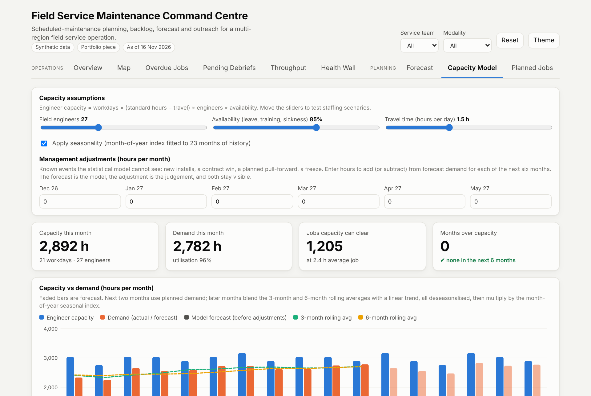
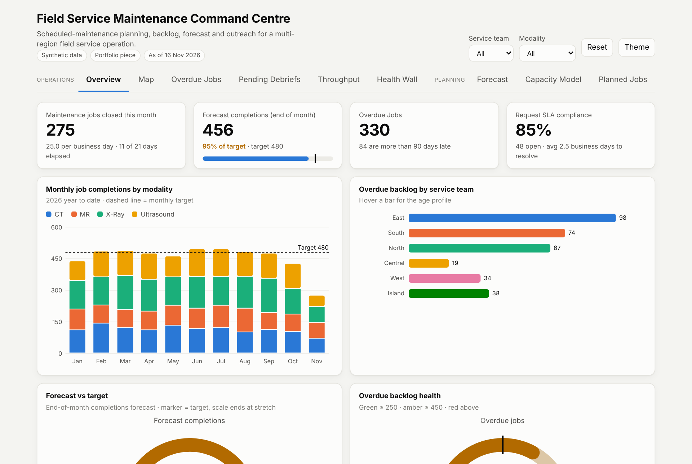
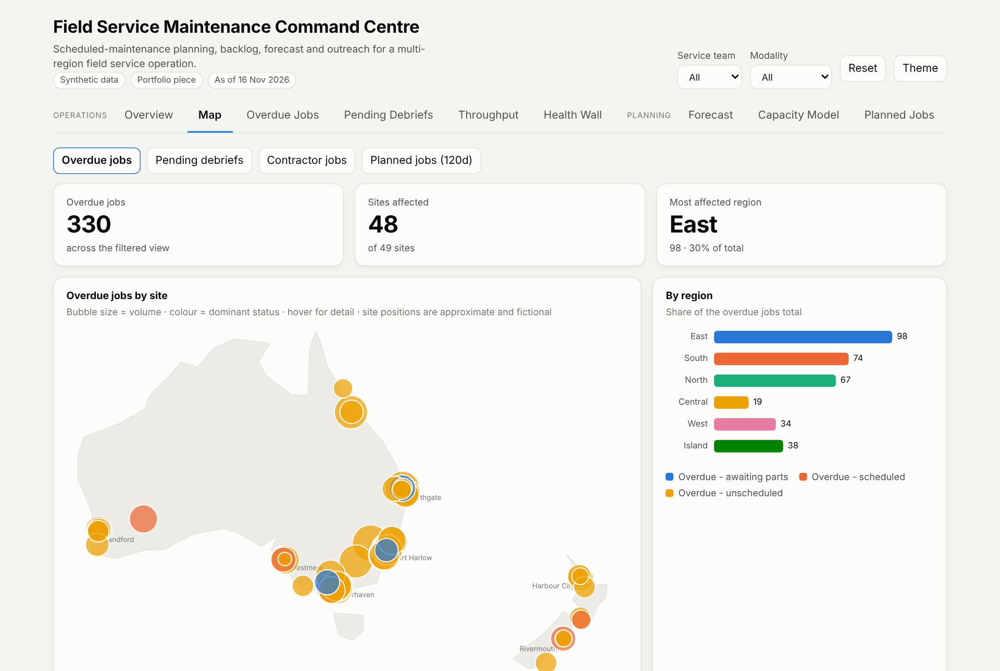
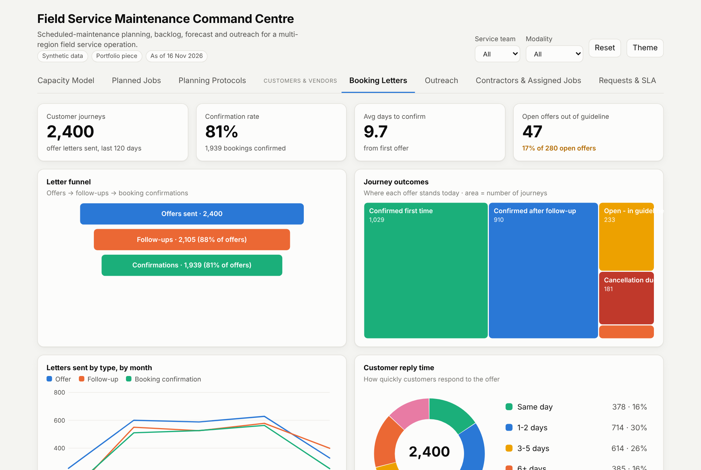

# Field Service Maintenance Command Centre

   

**Live demo:** https://jeremylegere-wq.github.io/field-service-dashboard/
(single file, no build step, no external libraries, no network calls)



An interactive, fully synthetic rebuild of a suite of Power BI reports I designed and maintained for a multi-region field service operation. The dashboards coordinated scheduled maintenance for diagnostic imaging equipment: what is due, what is overdue, who is booked, and whether there are enough engineers to do the work.

Everything in this repository is generated in the browser from a seeded random number generator. There is no real customer, site, people, contractor or financial data, and no employer branding. Regions, cities, sites, contractors and people are all invented. Only the structure of the original reports (the questions they answered, the measures, the visual choices) has been kept. The footer of the dashboard states that the data is synthetic.

---

## Contents

1. [What this demonstrates](#what-this-demonstrates)
2. [Try it](#try-it)
3. [Screenshots](#screenshots)
4. [Repository layout](#repository-layout)
5. [What the reports did](#1-what-the-reports-did)
6. [Data model](#2-data-model)
7. [Custom columns](#3-custom-columns-calculated-columns)
8. [Measures](#4-measures)
9. [The long-term forecast](#5-the-long-term-forecast-the-piece-i-am-proudest-of)
10. [Visuals and how they were built](#6-visuals-and-how-they-were-built)
11. [Build it yourself](#7-build-it-yourself)
12. [Design principles](#8-design-principles)
13. [Limitations](#9-limitations)
14. [About](#about)

---

## What this demonstrates

| Skill | Where to see it |
|---|---|
| Data modelling | Star schema, disconnected parameter tables, an inactive relationship used with `USERELATIONSHIP`, a governed adjustments table |
| Power Query | Cleaning messy text dates, merging a second system to correct stale status, reusable CSV loader function |
| DAX | Capacity maths, rolling averages, a least-squares trend, a seasonal index, backlog burn-down, month-end closure forecast |
| Forecasting | A blended long-term demand model with seasonality, plus a transparent management-adjustment layer |
| Dashboard design | One axis per chart, status colour paired with icon and label, heatmaps, gauges, a bubble map, dark mode, responsive layout |
| Decision support | A repeatable quarterly review process with fixed risk labels and recommendation headings |
| Documentation | A full build guide with sample data and checkpoint numbers so someone else can reproduce the model |

---

## Try it

**Online:** open the live demo link above.

**Locally:** download `index.html` and open it in any modern browser. There is nothing to install.

Things to try:

- Use the **Service team** and **Modality** filters. They apply to every tab.
- On **Capacity Model**, move the sliders for engineers, availability and travel time, switch **seasonality** on and off, and type hours into the **management adjustments** boxes. The model forecast stays visible as a dashed line while the adjusted demand moves.
- On **Forecast**, change the completion and pull-through rates to see the month-end forecast respond.
- Hover over any chart for the detail behind it, and use **Theme** to switch to dark mode.

---

## Screenshots

| | |
|---|---|
|  |  |
| **Overview:** closures against target, backlog and health gauges | **Map:** overdue work by site, sized by volume |
|  |  |
| **Capacity model:** supply against seasonal demand, with adjustments | **Booking letters:** from offer to confirmed visit |

---

## Repository layout

```
index.html                    the live demo (served by GitHub Pages)
README.md                     this file
docs/
  SETUP-GUIDE.md              step-by-step guide to building the model in Power BI
  images/                     screenshots used in this README
sample-data/
  jobs.csv                    synthetic maintenance jobs
  work_orders.csv             linked work orders
  sites.csv                   fictional sites with coordinates
  planned_visits.csv          output of a planning tool
  booking_letters.csv         customer offer-to-confirmation journeys
  management_adjustments.csv  governed input for human judgement
scripts/
  generate_sample_data.py     regenerates the CSVs (seeded)
```

---

## 1. What the reports did

| Area | Question it answered |
|---|---|
| Overview and Throughput | How many maintenance jobs have we closed this month, and are we on track against target? |
| Map | Where is the overdue work, and which sites are affected? |
| Overdue Jobs | How old is the backlog, what state is each job in, and who is holding it? |
| Pending Debriefs | Which completed visits are still waiting on paperwork, and how much forecast is at risk because of it? |
| Health Wall | Is every operational queue inside its green, amber and red thresholds? |
| Forecast | Will we hit this month's closure target? |
| **Capacity Model** | **Do we have enough engineer hours for the next six to twelve months, and where do we need to intervene?** |
| Planned Jobs | What has the planning run scheduled, and which planned jobs are at risk of failing? |
| Planning Protocols | What errors and warnings did the planning run produce, and which are actionable? |
| Booking Letters | How effective is the offer, follow-up and confirmation journey with customers? |
| Contractors and Assigned Jobs | Which jobs sit with contractors, and which jobs are assigned to an engineer but **not yet confirmed with the customer**? |
| Requests and SLA | How quickly are inbound requests being answered? |

### A note on "assigned, not confirmed"

A job in this state has been given to an engineer (or contractor) in the scheduling system, but the customer has not yet agreed the visit. It looks scheduled on a calendar, so it is easy to count it as safe. It is not. The Health Wall, the Contractors tab and the Map treat it as its own queue, with a four-week horizon, because the nearer the visit, the higher the chance it fails.

---

## 2. Data model

The original model was a star schema with three layers. The demo mirrors it with in-memory arrays.

| Layer | Original | In this demo |
|---|---|---|
| Fact: open work | One row per open maintenance job, with due date, estimated duration, lifecycle status, scheduled date | `PM` (about 5,900 rows) |
| Fact: closed work | Closed jobs back to a valid-history start date, with duration and closed date | monthly closures inside `PM` |
| Fact: planned work | Output of the planning tool: duration and travel time per planned visit | `PJ` |
| Fact: wear-part work orders | Open parts jobs matched to the next maintenance visit on the same system | `PROT` and `PLAN` (simplified) |
| Dimension: calendar | One row per day, with workday flag, year-month number, month label | generated in code (`bizDaysIn`) |
| Disconnected parameter tables | Field engineer count, availability %, travel time per day | the three sliders on the Capacity Model tab |

The three parameter tables were the key to making the model interactive. Each is a one-column table with no relationships. A `SELECTEDVALUE` measure reads whatever the user picks and falls back to a default, so the capacity maths responds to a slicer without touching the fact data.

---

## 3. Custom columns (calculated columns)

Calculated columns were used where a value had to be fixed per row before any slicer is applied: cleaning, keys, flags and bucket labels.

| Column | Purpose | Logic |
|---|---|---|
| `MatchKey` | Pair rows between the open-work table and the parts table | A shared key (built in the data prep step) so each parts job can be looked up against maintenance visits on the same equipment |
| `Has_Scheduled` | Turn messy scheduled-date text into a boolean | `TRIM` the text, treat blank and a lone `-` as "not scheduled", otherwise true |
| `ScheduledDate_Clean_DT` | A real date-time from a text export | `TRIM` the text; return blank for `-` or empty; otherwise `DATEVALUE + TIMEVALUE`, wrapped in `IFERROR` so one bad value cannot break the column |
| `LifecycleStatus_Corrected` | Fix status values the source system left stale | When a job points at a linked work order (identifier starts with a work-order prefix), `LOOKUPVALUE` the status from that work order, and `COALESCE` back to the job's own status otherwise |
| `IsOverdue` | Flag the backlog | Due before today, no visit booked on or before today, and an open or assigned status |
| `Next Visit Date` | For each parts job, find the next maintenance visit on the same equipment | `CALCULATE(MIN(date))` over the jobs table filtered to the same `MatchKey`, with a non-blank schedule date that is not in the past |
| `Next Visit Bucket` | X-axis label for the matching chart | `FORMAT(date, "yyyy-MM")`, or "No date (unscheduled)" when blank |
| Overdue age bucket | Heatmap columns | Days since due date, banded (the demo uses 0 to 14, 15 to 45, 46 to 90 and 90 plus; the exact band edges are illustrative) |

Rule of thumb I followed: **a column if it is used as an axis, a filter or a join key; a measure if it has to react to the user's selection.**

---

## 4. Measures

### 4.1 Counting and effort

```dax
Due Hours = SUM ( Jobs[EstimatedHours] )

Overdue Jobs =
CALCULATE (
    COUNTROWS ( Jobs ),
    Jobs[IsOverdue] = TRUE (),
    REMOVEFILTERS ( 'Calendar' )          -- a snapshot as of today, not sliced by due month
)
```

Two decisions are worth noting. A job is overdue only if it was due in the past **and** has no visit booked before today, so a job that is late but already scheduled is a different queue. And the calendar filter is removed deliberately in the headline overdue count so the KPI cannot be changed by the month axis it sits on. A monthly variant compares against the last day of each month so the same logic can be plotted as a time series.

### 4.2 Capacity

```dax
FE Capacity Hours =
VAR EffectiveHoursPerDay = MAX ( 0, [Std Hours per FE per Day] - [Travel Value] )
RETURN
    [Workdays] * EffectiveHoursPerDay * [FE Count Value] * [FE Avail Value]
```

Capacity is workdays in the month, multiplied by productive hours per day (7.5 standard, less travel), multiplied by engineers, multiplied by the share of time they are available for maintenance work after leave, training and project work. Travel is subtracted from the day, not from the month, because it varies with geography and is the lever regional managers most often challenged.

Derived measures:

- `Utilisation % = DIVIDE ( [Due Hours], [FE Capacity Hours] )`, with a target of 1.0 and a gauge maximum of 1.2
- `Capacity Gap = [FE Capacity Hours] - [Due Hours]`
- `Jobs Cleared by Capacity = DIVIDE ( [FE Capacity Hours], [Avg Job Duration] )`
- Overdue hours gauge: target is 5% of due hours, amber up to 20% above target, red beyond

### 4.3 Backlog burn-down

```dax
Net Job Delta     = [Due Jobs] - [Jobs Cleared by Capacity]
Projected Backlog = [Starting Backlog] + running sum of [Net Job Delta] up to the selected month
```

A cumulative measure built with `FILTER ( ALL ( Calendar ), YearMonthNumber <= current )`. Used to show a base scenario and an accelerated one side by side.

### 4.4 Closure forecast (current month)

This is the logic behind the Forecast tab.

```
Forecast = closed month to date
         + scheduled jobs x completion rate
         + MIN ( due but not scheduled,
                 remaining business days x average daily closures x pull-through rate )
```

A "net of debrief" variant subtracts scheduled jobs whose debrief is still pending from the scheduled contribution, because those are the ones most likely to slip. Sliders for completion rate and pull-through let a manager ask "what if we book harder?" and see the effect immediately.

---

## 5. The long-term forecast (the piece I am proudest of)

This was the most valuable thing I built, and the hardest to get right.

### The problem

Maintenance demand, installs, leave and travel time all move month to month and quarter to quarter. Problems tended to show up too late: missed jobs, last-minute escalations, and a scramble to borrow engineers from a region that did not have spare capacity either. Leadership needed a six-to-twelve month view of supply versus demand, by region and by modality, that a regional manager could sit down with and argue about.

### The model

**Supply** is the capacity measure in section 4.2, driven by three assumptions a regional manager can change.

**Demand** is built in two horizons, because the data is trustworthy in different ways at different distances:

| Months ahead | Demand used | Why |
|---|---|---|
| 0 to 2 | **Actual** due hours (open jobs plus planned visits) | Work is already in the system, so use it |
| 3 or more | **Average of three deseasonalised signals, then re-seasonalised** | No single method is reliable this far out, and demand has a clear annual shape |

The three signals blended for month three onwards:

1. **3-month rolling average** of due hours, for short-term momentum
2. **6-month rolling average**, for the medium-term level and to damp noise
3. **Linear trend**, a least-squares line fitted across the valid history

Before any of the three signals are calculated, the history is **deseasonalised** (see below), and the result is multiplied back by that month's seasonal index at the end.

```dax
Forecast Hours =
VAR _ahead = [Months Ahead]
VAR _model = DIVIDE ( [Level 3M] + [Level 6M] + [Trend Hours], 3 ) * [Season Idx Applied]
RETURN
    SWITCH ( TRUE (), _ahead <= 2, [Due Hours], _model )

Forecast Hours (Incl Planned) = [Forecast Hours] + [Planned Hours]
```

The least-squares slope and intercept are computed in DAX, not in a separate script. They summarise the month index and due hours into a small table in a variable, compute means, then `SUMX` the covariance and variance. Fitting the regression in DAX meant the forecast refreshed with the data and respected slicers, so a regional view got a regional trend.

Two details that mattered more than they look:

- **A valid-history start date.** Early records had a different data standard. A setting marks the first month that can be trusted, and all three signals ignore anything earlier. Without it the trend line was dragged by data nobody should have trusted.
- **Planned-work uplift.** Work that the planning tool has already scheduled sits outside the open-job table. It was added on top of both the actual and the forecast demand, so it still obeys the region and modality slicers.

### Seasonality

Maintenance demand has a clear annual shape. Leave periods, year-end inflow, fiscal-year effects and customer shutdowns push some months well above or below an average month. A straight trend through the raw history misses that, so it under-forecasts the peaks and over-forecasts the troughs, and in a capacity model that is exactly where the decisions are.

The seasonal layer works like this:

1. **Detrend.** Fit the least-squares line to the full valid history. For each month, divide actual due hours by the trend value for that month, giving a ratio that is above 1.0 when the month ran hot and below 1.0 when it ran cold.
2. **Average by calendar month.** Group those ratios by month of year (all Januaries together, all Februaries together, and so on).
3. **Normalise.** Scale the twelve averages so they sum to twelve (mean 1.0). The result is the **seasonal index**: 1.04 means that month typically runs 4% above an average month, 0.92 means 8% below.
4. **Deseasonalise the history.** Divide each month by its index. The 3-month average, 6-month average and the linear trend are all computed on this flattened series, so a quiet month no longer drags the level down or a peak month push it up.
5. **Re-seasonalise the forecast.** Multiply the blended forecast by the index for the month being forecast.

In the full model the index is built once as a small calculated table (twelve rows) from a monthly demand table. The complete DAX is in the [setup guide](docs/SETUP-GUIDE.md), section 5.

Things to be honest about:

- **It needs history.** With under two years of valid data, each calendar month has one or two observations, so the index is noisy. The valid-history cut-off therefore matters even more, and a toggle to switch the seasonal layer off is useful for sense checks.
- **It is a multiplicative model.** The seasonal swing scales with the level of demand. That suited this operation, where busy months were busy in proportion.
- **It does not know about one-off events**, which is the job of the management adjustments below.

In this demo the Capacity Model tab has an **Apply seasonality** checkbox, a chart of the fitted seasonal index by calendar month, and the forecast build steps beside it. The index is estimated from 23 months of synthetic history, and switching it off shows the flat forecast it replaces.

### The Capacity Model tab in this demo

It reproduces the same logic, with sliders for engineers, availability and travel, the seasonal index, and the rolling averages, forecast, utilisation, gap and overdue-hours gauges described above.

### Why I still did manual calculations

A model can only know what is in the data, and the most important inputs were not in the data. Installs were agreed in meetings. Leave was approved after the model was refreshed. A contract change or a deliberate decision to pull work forward could move a month by hundreds of hours. Management also asked for scenarios the model had no field for: "what if we lend two engineers to another region for March?", "what if overtime is approved?", "what if this install slips a month?"

So the workflow became:

1. Run the model to get a defensible statistical baseline.
2. Take the baseline into the review conversation with each regional manager.
3. Capture the known events and management decisions on the spot, in hours.
4. Apply them manually (a spreadsheet beside the report) to produce an adjusted demand and capacity line per region and modality.
5. Classify the result, write the recommendation, and keep a record of what was baseline and what was judgement.

The key discipline was **never blending the two silently.** The statistical forecast and the human adjustment always stayed separate, so anyone could see which part was the model and which part was a decision.

To show that, this demo includes **Management adjustments** on the Capacity Model tab. Enter hours to add or subtract for each of the next six months. The adjusted demand drives utilisation, the gap chart and the gauges, while a dashed line keeps the unadjusted model forecast visible.

If I rebuilt this today, I would move those adjustments into a governed input table inside the model (month, region, modality, hours, reason, approver), so they refresh, are auditable, and no longer depend on a side spreadsheet. The [sample data](sample-data/management_adjustments.csv) and [setup guide](docs/SETUP-GUIDE.md) show exactly that pattern.

### The quarterly review it supported

The model fed a repeatable quarterly cycle:

1. Internal review of the next 90 to 180 days, validating assumptions and risks
2. Regional and modality views prepared from the model
3. Alignment sessions with regional managers and coordinators to confirm engineer availability and known constraints
4. A follow-up decision meeting; this was planning and alignment, not performance review

Each region submitted **one standard slide** per service line:

- **Capacity snapshot:** capacity range and demand range across the six months, stated as ranges rather than point values, with direction of trend
- **Peak and trough months:** named months, with the estimated gap in hours
- **Risk classification:** exactly one of four labels: *Overload*, *Backlog persistence*, *Underutilisation*, *Timing risk*
- **Recommendations:** under four fixed headings: Requests, Reallocate Resources, Escalations for Decision, Key Summary. Every recommendation names the months, quantifies the effort in hours or FTE and states the operational outcome

Forcing the same four risk labels and four headings meant a national roll-up could be read in minutes, with a red, amber and green summary per region.

---

## 6. Visuals and how they were built

| Visual | Built from | Notes |
|---|---|---|
| KPI cards | Single measures with conditional text | Status pill pairs an icon with a label so colour is never the only signal |
| Clustered columns and stacked columns | Measure by month or category | Forecast months drawn at reduced opacity to separate actual from projected |
| Line chart with rolling averages | 3M and 6M rolling-average measures | Dashed lines so they read as derived, not observed |
| Combo chart | Original used columns plus a percentage line on a secondary axis | **In this rebuild it is two charts or a single-axis combo.** Dual axes were removed because two scales on one chart mislead |
| Gauges | A measure, a target measure and a maximum measure | Green, amber and red bands from thresholds; the Health Wall is a grid of them |
| Heatmaps | Matrix visual with conditional-format background | Overdue status by days overdue; risk bucket by modality; protocol code by category |
| Map | Bubble map by site | Bubble size is volume, colour is dominant status. Here drawn with SVG on a simplified outline, with fictional positions |
| Treemap, donut, funnel | Category plus count | Funnel for offer, follow-up, confirmation; treemap for journey outcomes |
| Pareto | Bars plus cumulative share | Drawn as bars and a separate cumulative chart in this rebuild |
| Tables | Top N by age, risk or days quiet | Action lists for planners |

Interaction in the demo: every chart has a hover tooltip, crosshair on line charts, a region and modality filter that applies everywhere, dark mode, and a layout that works on a phone.

---

## 7. Build it yourself

This repository includes everything needed to rebuild the model in Power BI Desktop:

- **[docs/SETUP-GUIDE.md](docs/SETUP-GUIDE.md):** a step-by-step guide covering the parameter setup, Power Query (Advanced Editor) code for every table, relationships, all the DAX, page-by-page visual instructions, and a troubleshooting table.
- **[sample-data/](sample-data/):** six synthetic CSV files that load straight into the guide's queries.
- **[scripts/generate_sample_data.py](scripts/generate_sample_data.py):** regenerates the data, seeded so the output is identical every time.
- **Checkpoint numbers:** the guide lists the values your model should return on the sample data (for example, overdue job count and the seasonal index for each month), so you can confirm it is wired correctly before building any visuals.

Estimated time: two to three hours for the model and the first two report pages.

---

## 8. Design principles

- **One axis per chart.** Two measures on different scales become two charts, never a dual axis.
- **Colour follows meaning.** A series keeps the same colour on every chart. Status colours are always paired with an icon or a label.
- **Actual versus derived.** Solid lines and full colour for actuals, dashed lines and lighter fill for averages and forecasts.
- **Every chart answers a question.** Titles say what to look for, not just what is plotted.
- **Keep the model and the judgement separate.** Statistical output and human adjustment are always visible as different things.
- **Test with known numbers.** Checkpoint values catch model errors before the visuals hide them.

---

## 9. Limitations

- The forecast is a demonstration of method on synthetic data. The numbers mean nothing operationally.
- The linear trend assumes roughly stable growth, and the seasonal index assumes the annual pattern repeats. Structural changes (a new contract, a new region, a change in service policy) break both, which is what the management adjustments are for.
- The Pareto, secondary-axis and some custom-visual features of the original were simplified for clarity.

---

## About

Built by **Jeremy Legere**.

- LinkedIn: [linkedin.com/in/jeremylegere](https://www.linkedin.com/in/jeremylegere)
- GitHub: [jeremylegere-wq](https://github.com/jeremylegere-wq)

All data in this repository is synthetic. Please feel free to learn from the approach, and credit the repository if you reuse it.
